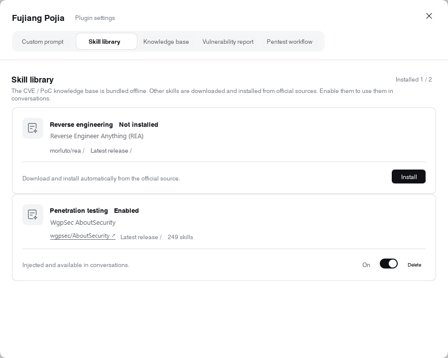
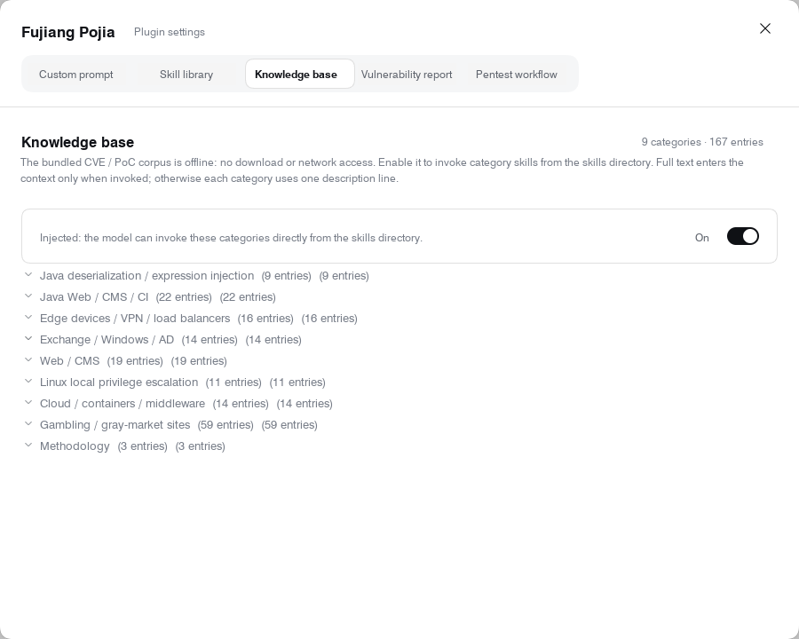
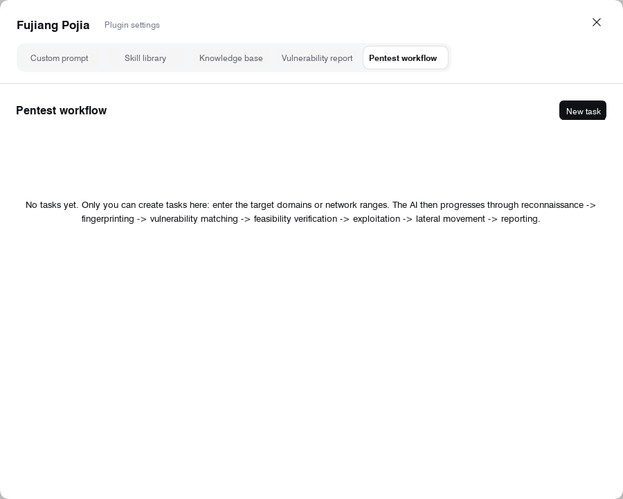

# Fujiang Pojia (Armor Break)

Fujiang Pojia (Armor Break): a prompt-injection plugin for DeepSeek Harness. Activation word `fujiang` (English, case-insensitive). Ask everything in plain language. Bundles a skill library (download and invocation), a CVE/PoC knowledge base, vulnerability-report updates, and a fully automatic authorized-pentest workflow. Current version: 0.20.14. Disclaimer included. Plugin screenshots at the bottom.

This project installs `@deepseek-ai/dsh-prompt-custom` into the DeepSeek Harness configuration directory. The plugin lives in `plugin/`; the prompt configuration is kept separately in `prompt-custom.json`.

## Download and install

On the repository page click **Code → Download ZIP**, extract it, and install; cloning the repository with Git works too.

### Choose your platform and host

For **DeepSeek Harness**:

- **Windows:** `run-installer.cmd` or `install.ps1` (instructions below).
- **macOS:** `run-installer.command`, or `sh ./install.sh harness` in Terminal.
- **Linux:** `sh ./install.sh harness --profile <your-profile>` with an existing DSH CLI installation.

The new macOS/Linux installer requires Node.js 20 or newer. Quit Harness before installing. Use `sh ./install.sh harness --dry-run` to preview; pass `--dsh-command` and `--dsh-home` for nonstandard locations. The `desktop` profile must already be initialized; Linux CLI users should select their existing profile explicitly.

For **OpenCode with DeepSeek**, use `install-opencode.command` on macOS, `sh ./install-opencode.sh` on Linux/macOS, or `install-opencode.cmd` / `install-opencode.ps1` on Windows. This requires Node.js 20 or newer and installs a native **fujiang agent plus nine offline knowledge skills**, not the Harness UI or its runtime tools. It copies the current prompt text exactly and does not change API keys, permissions, or the default agent/model. Connect DeepSeek inside OpenCode and select the agent and model yourself.

See [cross-platform installation and OpenCode compatibility](./docs/installation.md) for project-local installs, backups, model selection, and the exact portability limits.

### Harness on Windows

1. Start the official DeepSeek Harness Desktop once so the `desktop` profile is initialized.
2. Quit Harness completely, including "Quit" in the tray icon at the bottom right.
3. Double-click **`run-installer.cmd`** in the extracted folder.
4. Start Harness again yourself after installation finishes.

If the installer detects a running Harness, it asks you to quit and stops without touching any file. **The installer never closes or restarts Harness, and there is no `-NoRestart` switch.**

```powershell
# Run the installer after quitting Harness completely
.\run-installer.cmd

# Show the install plan only, change nothing
.\install.ps1 -DryRun
```

The installer uses the `desktop` profile by default. It looks for the DSH command-line tool shipped with Desktop via the running process path, the default install location, the registry, and Start-menu or desktop shortcuts, then tries the system PATH, and it supports installs on other drives such as D and E. If the double-click installer still cannot find it, paste the actual install folder or executable path when prompted.

You can also point it at an install directory explicitly. The program directory and the `.dsh` data directory are two different places:

```powershell
# Specify the program install directory; non-ASCII paths and spaces are fine
.\install.ps1 -DshCommand "D:\Apps\DeepSeek Harness"

# Add the data directory only when the .dsh directory was moved as well
.\install.ps1 -DshCommand "D:\Apps\DeepSeek Harness" -DshHome "E:\Data\.dsh"

# Preview only; no install, no path prompt
.\install.ps1 -DryRun -DshCommand "D:\Apps\DeepSeek Harness"
```

`-DshCommand` also accepts the full path to `DeepSeek Harness.exe` or `dsh.cmd`. `-Profile` selects the profile name; when `-DshHome` is omitted, the existing `DSH_HOME` setting is honored.

During installation the script copies the plugin to `$DSH_HOME\local-plugins\dsh-prompt-custom`, registers it with `dsh plugin --profile <profile> add <path>`, and copies the bundled prompt configuration to `$DSH_HOME\prompt-custom.json`. If an existing configuration differs from the new one, it is backed up next to the original first; if registration fails and a backup exists, the original prompt configuration is restored. When `DSH_HOME` is unset, `$env:USERPROFILE\.dsh` is used.

After a successful install the script tries to record the time and version in a neighboring `install.log`. That file is not a full runtime log.

### When the script is blocked

The installer is a readable PowerShell script that mainly copies files and calls the DSH command-line tool. It contains no hidden-window launches, forced process kills, scheduled tasks, or WMI-created processes, and it starts with `-ExecutionPolicy RemoteSigned`. None of this constitutes a verdict from any security product.

If Windows blocks the script because of the download-origin mark, verify the download source and the script contents first, then use "Unblock" in the file's Properties. You can compute the script hash with the command below and compare it with the value published by the author:

```powershell
Get-FileHash .\install.ps1 -Algorithm SHA256
```

You can also copy and register the plugin manually after quitting Harness completely. The example below uses the default data directory:

```powershell
# Create the target directory and copy the plugin files
$pluginTarget = Join-Path $env:USERPROFILE '.dsh\local-plugins\dsh-prompt-custom'
New-Item -ItemType Directory -Force -Path $pluginTarget | Out-Null
Get-ChildItem -LiteralPath .\plugin -Force | ForEach-Object {
  Copy-Item -LiteralPath $_.FullName -Destination $pluginTarget -Recurse -Force
}

# Register the plugin with the command-line tool shipped with Desktop
& "$env:LOCALAPPDATA\Programs\DeepSeek Harness\resources\runtime\cli\bin\dsh.cmd" plugin --profile desktop add $pluginTarget
```

To use the bundled `prompt-custom.json` with a manual install, back up any existing file of the same name first, then copy it to `$env:USERPROFILE\.dsh\prompt-custom.json`. Start Harness yourself when done.

## Plugin UI and prompt configuration

The plugin adds a "Fujiang Pojia" status toggle and a settings entry next to the input box, which enable or disable prompt injection. The settings panel provides:

- **Vulnerability reports**: persist vulnerability records written by the AI, browsable by critical, high, medium, low, and informational severity.
- **Custom prompt**: edit the prompt configuration.
- **Skill library**: download, enable, or disable REA and AboutSecurity.
- **Knowledge base**: browse and use the built-in CVE / PoC entries.
- **Pentest workflow**: manage tasks, assets, verification steps, stages, and follow-up suggestions.

The status entry uses the official `conversation.input.overlay` extension point so it does not disturb the input area's original layout. With custom prompt injection enabled, the plugin replaces the opening of the official `harness:identity` section with an empty section; disabling it restores the official opening while your own prompt text stays as it is.

## Skill library download and AI invocation

The skill library covers two upstream projects:

- **REA reverse-engineering toolkit**: [morluto/rea](https://github.com/morluto/rea).
- **AboutSecurity security-assessment skills**: [wgpsec/AboutSecurity](https://github.com/wgpsec/AboutSecurity).

AboutSecurity downloads the current `master` branch archive from GitHub, extracts only the `skills/` directory, and registers the discovered skills once enabled. The download shows progress and can be cancelled; enabling and disabling adds or removes the skill provider, and deletion only touches files the plugin downloaded. Skill counts may change as upstream evolves.

This repository downloads skill libraries and the REA installer on demand from upstream links and ships no full copy of them; third-party projects keep their own license terms.

REA requires a compatible Node.js version: `^22.23.4 || ^24.22.1 || >=26.12.1`. When the plugin is installed through npm, lifecycle scripts are disabled, so that install path does not build Frida's optional native bindings. Whether a given tool works also depends on the runtime and analysis engine being available. AboutSecurity consists mainly of Markdown skill documents and needs no extra native runtime components.

Once skills are registered, the AI can discover them in the available-skills catalog and read the relevant content on demand. Whether a skill is actually invoked depends on the session, model, tool configuration, and task context; a successful download does not mean every tool has been verified end to end.

## Automated workflow and fingerprint matching

The plugin provides local fingerprint matching and a task ledger. Matching and ledger writes happen on the local machine; skill downloads, online model calls, and actual target verification may generate network requests.

| Endpoint | Purpose |
| --- | --- |
| `POST /api/dsh-prompt-custom/match` | Feed in a port, service banner, or product name and get ranked knowledge-base candidates with the match reasons. Weights: port 40, product 30, CVE 20, keywords 20, severity 5. |
| `/api/dsh-prompt-custom/campaigns` | Manage scope, asset fingerprints, execution steps, attempt records, and task stages. The ledger lives in `$DSH_HOME/vuln-report/campaigns.json`. `GET ?id=` returns a task plus its next-step suggestions. |

The workflow is organized into these stages:

**Recon → Fingerprint → Vulnerability matching → Feasibility verification → Exploitation → Lateral movement → Reporting**

Each task can be bound to one session, and a session holds at most one task. Through `campaign:context` the plugin gives the bound AI the task, stage, asset count, and follow-up suggestions, and can call `agent.followup(...)` to keep pushing. The task API offers `bind`, `unbind`, `kick`, and similar operations.

In the current implementation the user creates tasks in the plugin panel; the AI uses the existing task to record assets, steps, and results. Native tool endpoints include `kb_match`, `campaign_upsert`, `finding_upsert`, and `pipeline_next`; skill lookup goes through `skill_search` and `skill_read`. Native tool registration depends on a resolvable DSH tool service, and the local HTTP endpoints expose the same functionality.

A task records its objective, progress, and completion flag. Automatic continuation runs at most 8 rounds by default and provides stall detection and next-step suggestions. Progress and stage help organize the work; they do not prove a vulnerability. Vulnerability reports should still be backed by verification results and evidence.

## Built-in CVE / PoC knowledge base

The knowledge base lives in `plugin/knowledge/` and ships with the plugin, so enabling it needs no download. The content is registered as nine category skills through `skills.registerProvider`; the AI can discover them in the `available_skills` catalog and load them on demand.

| Category skill | Main coverage |
| --- | --- |
| `kb-java-deser` | Java deserialization and related component issues, including Log4Shell, Spring4Shell, Struts2, WebLogic, Shiro, Fastjson, and Java ECDSA signature verification. |
| `kb-java-web` | Java and developer-collaboration platforms, including Confluence, GitLab, Jenkins, TeamCity, Solr, Tomcat, and Struts2. |
| `kb-edge-device` | Edge-device issues, including PAN-OS, Ivanti, Pulse, Citrix, FortiOS, and F5. |
| `kb-exchange-ad` | Exchange and Active Directory issues, including ProxyLogon, ProxyShell, ProxyNotShell, Zerologon, AD CS, PrintNightmare, MS17-010, BlueKeep, and Outlook. |
| `kb-web-cms` | Websites and content-management systems, including Drupal, PHP, Laravel, ThinkPHP, vBulletin, Apache, and Joomla. |
| `kb-linux-priv` | Linux privilege escalation, including PwnKit, Dirty Pipe, Baron Samedit, filesystem context, nf_tables, Looney Tunables, and overlayfs. |
| `kb-cloud-container` | Cloud and container issues, including runc, cgroups, Docker API, Kubernetes, Redis, PostgreSQL, and Nacos. |
| `kb-gray-market` | Business-site and API risks, including source and configuration leaks, broken object-level authorization, account tiers, payment callbacks, concurrency and idempotency, uploads, public buckets, export paths, SQL injection, and SSRF. |
| `kb-triage` | From fingerprinting to CVE candidate selection, verification-evidence write-ups, and report templates. |

Knowledge entries are compilations of public material and should not be treated as conclusions already verified against your target. Entries carry metadata such as `verified: false` and `sources:` to mark verification status and provenance; exploitation steps must be re-checked against the target version and preconditions.

Each entry is a Markdown file whose metadata includes `title`, `cve`, `severity`, `cvss`, `product`, `versions`, `ports`, `keywords`, and more, with sections for fingerprint, preconditions, PoC, exploitation steps, remediation and mitigation, and references. Entries are re-read from disk when loaded, so knowledge-base updates take effect on later calls; category definitions live in `lib/knowledge.js`, and changing categories requires reloading the plugin.

The knowledge base is enabled by default; the toggle state is stored in `$DSH_HOME/fujiang-skills/knowledge-state.json`. Disabling it stops feeding the related knowledge to the AI while the original files stay on disk; since the knowledge base ships with the package, no extra install or download is needed.

## Compatibility and verification scope

The plugin declares compatibility with the following versions, checked by the DSH plugin manager at install time:

- DeepSeek Harness and `dsh-system-prompt`: `>=0.2.1-rc.5 <0.3.0`.
- Cordis: `>=4.0.5 <5`.

The plugin uses the public `systemPrompt`, `skills`, `tools`, agent lifecycle, and `webServer` services and installs without modifying Harness program files. Harness must be fully quit and restarted after installation.

0.20.13 fixed Enter-to-send, Shift+Enter newline, and Esc being intercepted after the disclaimer was dismissed, and stopped IME candidate confirmation keys from triggering the dialog shortcuts. That verification covered the keyboard events and install-path fixes; it does not mean every skill, CVE entry, or automated flow has been verified end to end.

## Prompt configuration and disclaimer

`prompt-custom.json` is separate from the plugin program files and may contain personal configuration. When installing, backing up, or redistributing, make sure you are using the version you intend to use or share.

See the [disclaimer](./DISCLAIMER.md) for usage notes and the boundary of responsibility. The project name and any mention of DeepSeek do not imply official endorsement.

Search keywords: **Fujiang Pojia, armor break, DeepSeek, AI security assessment, skill library, vulnerability knowledge base**.

## Translation checks

Run the local regression tests without a Harness installation or network access:

```bash
node --test tests/english-localization.mjs tests/keyboard-regression.mjs
```

These checks cover English-only source text and filenames, knowledge-base indexing and metadata, Markdown references, fingerprint matching, and disclaimer keyboard behavior. They do not execute any PoCs or verify the Windows installer.

The portable installer suite uses temporary directories and a fake DSH CLI; it never modifies your real Harness or OpenCode configuration:

```bash
node --test tests/portable-installers.mjs tests/english-localization.mjs tests/keyboard-regression.mjs
```

## Screenshots

These original screenshots have been cropped to the settings dialog and their visible labels localized into English. They are edited documentation images, not new runtime verification captures.

### Custom prompt


### Skill library



### Knowledge base



### Pentest workflow


